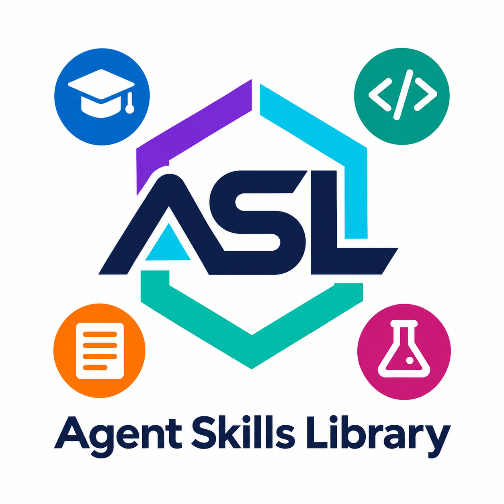

# Skills Library

Collection of skills for AI agents.

- [AI](./ai/) - skills for working with artificial intelligence
- [common](./common/) - common skills for all agents
- [development](./development/) - skills for software development
- [documents](./documents/) - skills for creating and managing documentation (OCR, translation, structuring, technical docs, etc.)
- [education](./education/) - skills for learning, education content creation and evaluation
- [testing](./testing/) - skills for testing and QA

## Skill Catalog

Browse the complete categorized catalog in [English](./_docs/skills.md) or [Russian](./_docs/skills.ru.md).

## Pipelines

Pipelines describe multi-stage workflows that coordinate skills, define stage handoffs, and set quality gates.

- [Scientific Article Preparation](./_pipelines/write-an-article/AGENTS.md) - defines the workflow from research framing and source discovery through analysis, article preparation, and independent review, including revision and completion criteria.

## Skill Tests

Skill tests are reusable prompt scenarios. Use them to manually check whether a skill follows its instructions across representative cases; these prompt files are evaluation scenarios, not automatically executable tests.

- [Research Source Finder test scenarios](./_tests/documents/research-source-finder/) - cover direct comparative research, an interdisciplinary topic with structured metadata export, and a narrow topic where few or no directly relevant sources may exist.

## Install and Use Skills

See the [English guide](./_docs/usage.md) or [Russian guide](./_docs/usage.ru.md) for installation, usage examples, dependencies, and extension guidance.
