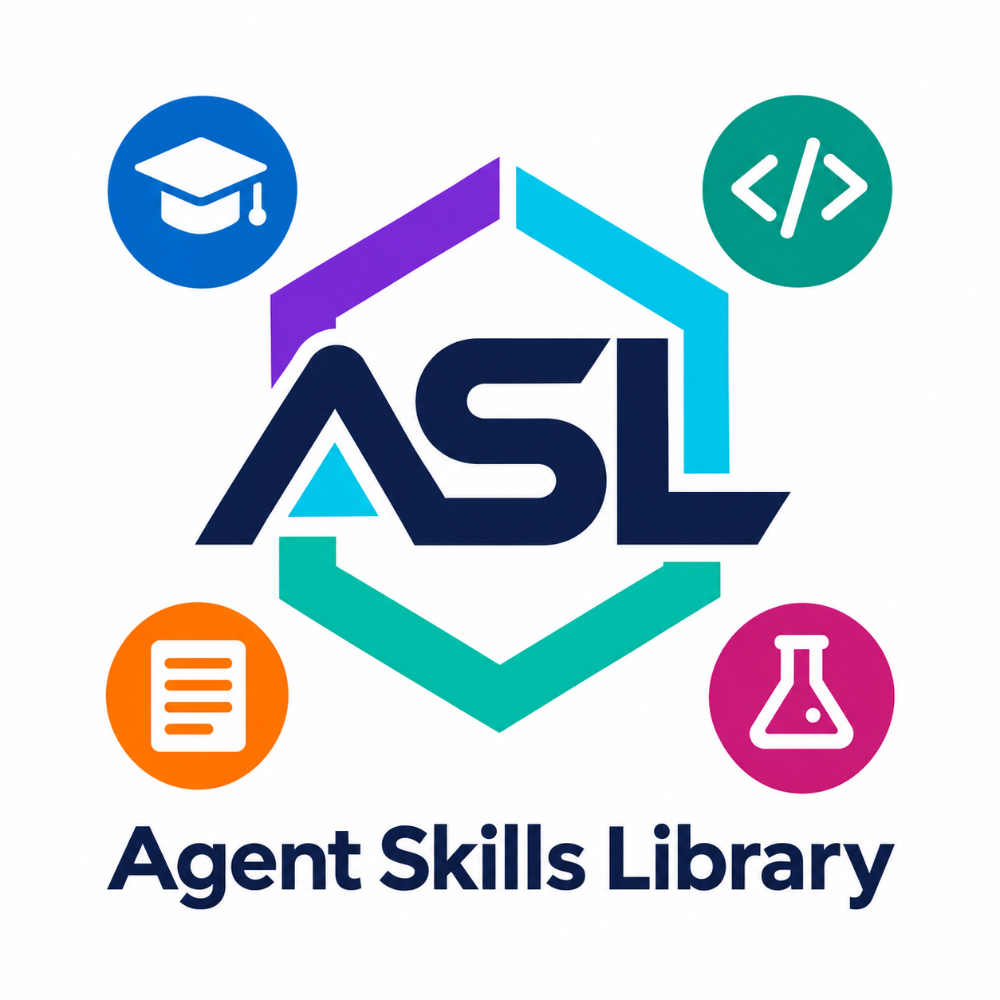

# Библиотека навыков

Коллекция навыков для AI агентов.

1. [AI](./ai/) - навыки для работы с искусственным интеллектом
2. [common](./common/) - общие навыки для всех агентов
3. [development](./development/) - навыки для разработки программного обеспечения
4. [documents](./documents/) - навыки для создания и управления документацией (OCR, перевод, структурирование, техническая документация, и т.д.)
5. [education](./education/) - навыки для обучения, создания образовательного контента и проверки знаний
6. [testing](./testing/) - навыки для тестирования и QA

## Каталог навыков

Полный каталог по категориям: [на русском](./_docs/skills.ru.md) и [на английском](./_docs/skills.md).

## Конвейеры

Конвейеры описывают многоэтапные рабочие процессы: задают последовательность этапов, передачу результатов между навыками и контрольные критерии качества.

- [Подготовка научной статьи](./_pipelines/write-an-article/AGENTS.md) — процесс от формулировки исследования и поиска источников до анализа, подготовки статьи и независимого рецензирования, включая критерии доработки и завершения.

## Тесты навыков

Тесты навыков — повторно используемые сценарии-запросы для ручной проверки поведения навыка на разных типовых случаях; эти prompt-файлы являются сценариями оценки, а не автоматически запускаемыми тестами.

- [Сценарии для Research Source Finder](./_tests/documents/research-source-finder/) — проверяют поиск прямых сравнительных исследований, междисциплинарную тему со структурированным экспортом метаданных и узкую тему, по которой может найтись мало или не найтись прямых источников.

## Установка и использование навыков

Инструкции по установке, примеры использования, зависимости и рекомендации по расширению вынесены в отдельные документы: [на русском](./_docs/usage.ru.md) и [на английском](./_docs/usage.md).
